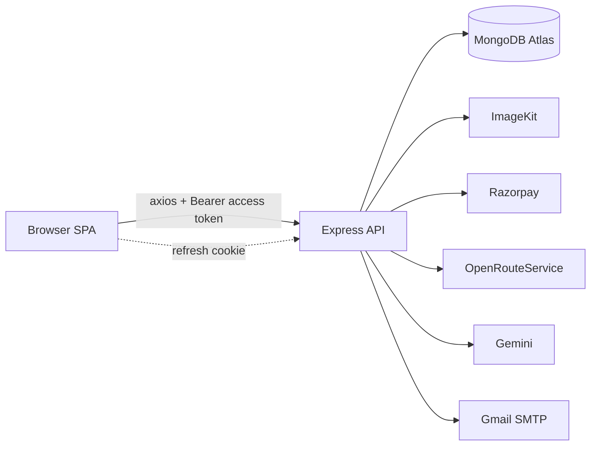
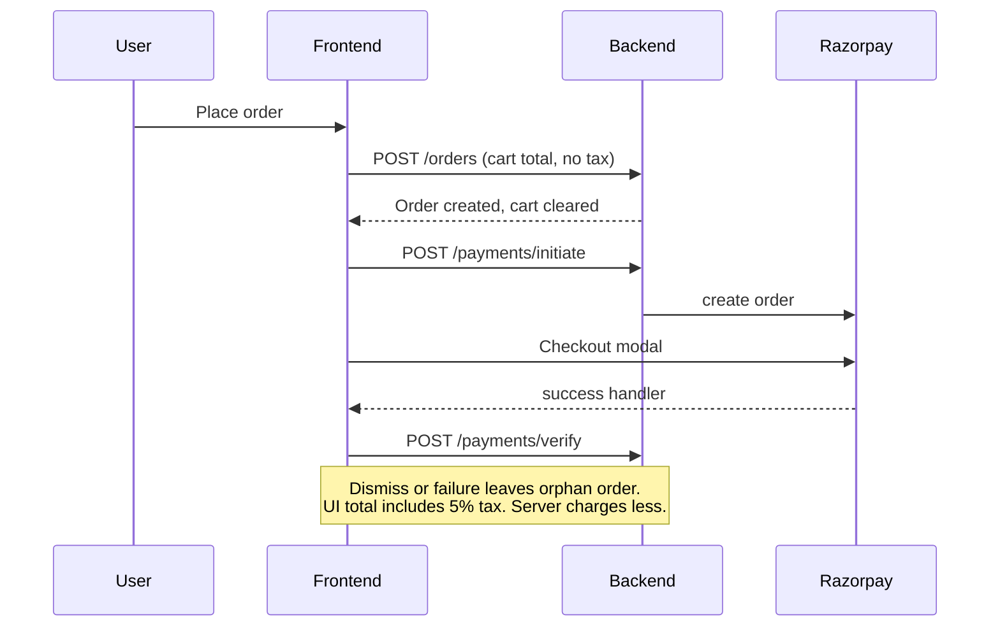
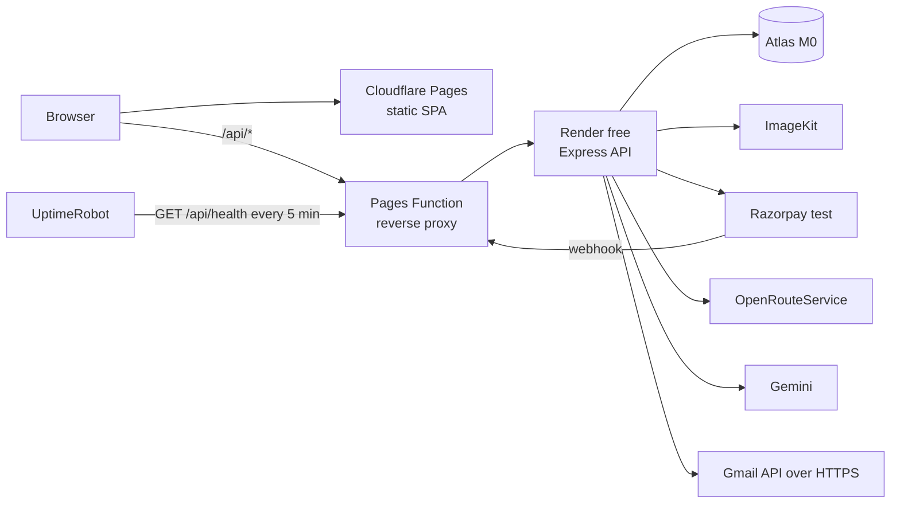
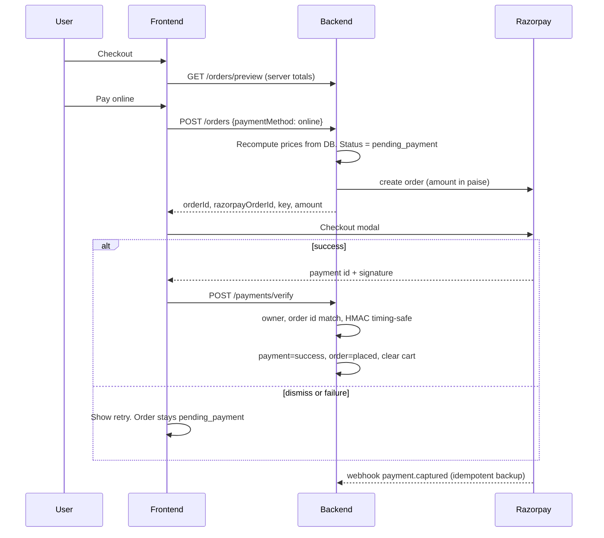
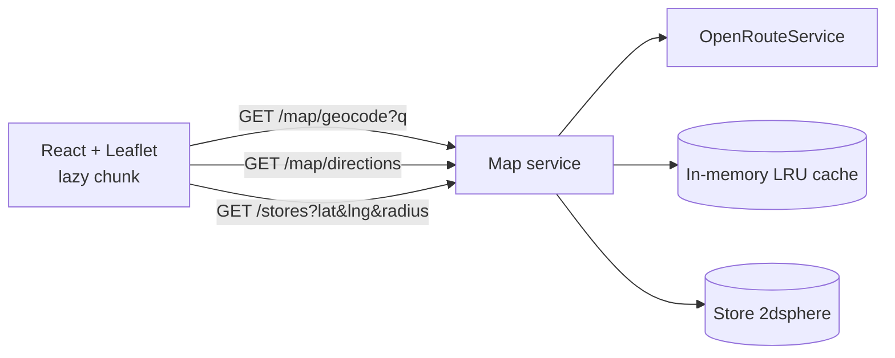

# Munchy — Architecture

Two views: **current** (as audited) and **target** (after FIXES.md). Source of truth for routes: `backend/src/routes/*.js`. Source of truth for env: `backend/src/config/config.js`.

## 1. Current state

### Stack
| Layer | Tech |
|-------|------|
| Frontend | React 19, Vite 8, react-router 7, TanStack Query 5, Zustand 5, axios, CSS Modules, lucide icons |
| Backend | Node, Express 5, Mongoose 9, Passport (Google OAuth), JWT, bcrypt, multer 2, express-rate-limit 8 |
| Database | MongoDB Atlas |
| Media | ImageKit |
| Payments | Razorpay |
| Routing / geo | OpenRouteService (backend service) |
| AI | Gemini via LangChain (`@langchain/google-genai`), chatbot |
| Email | nodemailer over Gmail SMTP |
| Hosting (legacy) | Netlify function wrapper (`serverless-http`) |

### Backend layering
```
route → validator/middleware → controller → dao → model
                                   └→ services (email, storage, map, ai)
```
Controllers hold request logic. DAOs hold queries. Models hold schemas. Keep this.

### Domain model (entities)
User, Partner, Session (refresh tokens), Store (GeoJSON `location`, 2dsphere index), Food, Cart, Order, Payment, Reel, Like, Comment, Review, Favourite.

Notes from audit:
- `Order.payment` is never assigned. Payment links to order one way only.
- Payment status values are not aligned with UI checks (`success` versus `paid`).
- Food refers to its partner by a field named `Partner` (capitalised). Leave name, but treat as legacy.
- Only a few indexes exist: Store 2dsphere, Like (reel,user), Favourite (user,store), Review (user,food), unique emails.

### Current request flow


### Current checkout flow (problematic)


### Known structural issues
See `FIXES.md` for IDs. Summary: money logic split between client and server, no payment webhook, map stack missing on frontend, SMTP incompatible with Render free, access token in OAuth redirect URL, rate limiter counts refresh calls.

---

## 2. Target architecture

### Topology (free tier)


Why a proxy: SPA and API share one origin. Refresh cookie stays first-party and `sameSite: strict`. No cross-site cookie blocking. No CORS in production.

### Regions
- Render: Singapore (closest free region to India).
- Atlas M0: AWS Mumbai. Verify Render-to-Atlas latency after deploy.

### Target checkout flow


### Order state machine (target)
```
pending_payment → placed → (existing statuses in order.model.js) → pickedup/completed
pending_payment → cancelled        (no refund)
placed|confirmed → cancelled       (refund if online and paid)
```
Keep existing intermediate statuses. Add only `pending_payment`. Lazy-expire `pending_payment` older than 30 minutes on read.

### Payment record rules
- One Payment per order. Unique index on `order`.
- Fields: order, user, method (`online|cash`), status (`pending|success|failed|refunded`), amountPaise, gatewayOrderId, gatewayPaymentId, signature, refundId.
- `Order.payment` references Payment.
- Online success set only by verify or webhook. Both idempotent.
- Cash success set at pickup verification.

### Pricing rules
- Server constant `TAX_RATE = 0.05`.
- All money handled in integer paise inside payment code. Convert at the edges.
- Order stores `subtotal`, `tax`, `totalPrice`.
- Frontend displays server numbers. Frontend never computes totals.

### Map architecture

- Tiles: OpenStreetMap with attribution. Dark look via CSS filter on tile pane.
- Geocode and directions go through backend. Key never reaches browser.
- Directions use ORS GeoJSON endpoint. No polyline decoding needed.
- Stores query uses `$geoNear`. Returns `distanceMeters`.

### Auth architecture (target)
- Access token: 15 min, memory + localStorage as today. Refresh token: httpOnly, secure, `sameSite: strict`, path `/api/auth`.
- Google callback goes through the proxy (`https://<pages-domain>/api/auth/{user|partner}/google/callback`). Cookie lands on the Pages origin. Redirect to `/auth/success?role=...`. SPA then calls `POST /api/auth/refresh` to get the access token. No token in URL.
- Rate limits: strict limiter on login, register, OTP, forgot. Refresh and `me` use a normal limiter.
- `app.set('trust proxy', 1)` on Render.

### Email
`sendEmail({to, subject, html})` keeps its signature. Implementation swaps from SMTP to Gmail API over HTTPS using OAuth refresh token with `gmail.send` scope. Dev fallback: log to console.

### Media
- Upload through backend for now. Memory storage. Lower video limit to 25 MB.
- Optional later: client-direct ImageKit upload with signed token.
- Read side uses ImageKit URL transformations (see `PERFORMANCE.md`).

### Environment matrix
| Where | Variable group | Notes |
|-------|----------------|-------|
| Render | `NODE_ENV=production`, `PORT`, Mongo URI, JWT secrets, cookie settings | Strong random secrets |
| Render | `FRONTEND_URL` = Pages URL | Used for redirects, CORS allowlist |
| Render | Google client id/secret, callback URLs on Pages domain | Add to Google console |
| Render | Razorpay key id/secret, webhook secret | Test mode |
| Render | ImageKit keys, ORS key, Gemini key | |
| Render | Gmail API client id/secret/refresh token | Scope `gmail.send` |
| Pages (build) | `VITE_API_URL=/api` | |
| Pages (runtime) | `RENDER_API_ORIGIN` | Used by proxy function |

Names follow `config.js`. Add every new variable to `.env.example`.

### Observability
- `pino-http` or `morgan` one line per request with request id.
- Central error handler returns `{message}` and logs stack.
- UptimeRobot on `/api/health`. Health route does no DB call. `/api/health/db` pings Mongo.

### CI
GitHub Actions: install, lint, build frontend; install, lint, tests backend. Block merge on failure.

## 3. Directory changes (target)
```
frontend/src/
  styles/tokens.css, base.css
  components/ui/        Button, Card, Chip, Input, Sheet, Skeleton, Toast, EmptyState, Badge
  components/map/       MapView, StoreMarker, LocationPicker, RouteLayer   (lazy)
  store/locationStore.js
  lib/img.js            ImageKit URL helper
frontend/functions/api/[[path]].js     Cloudflare Pages proxy
frontend/public/_redirects             SPA fallback
backend/src/services/map.service.js    geocode, directions, cache
backend/src/services/email.service.js  Gmail API
backend/src/services/pricing.service.js
backend/src/controllers/webhook.controller.js
backend/render.yaml
.github/workflows/ci.yml
```
