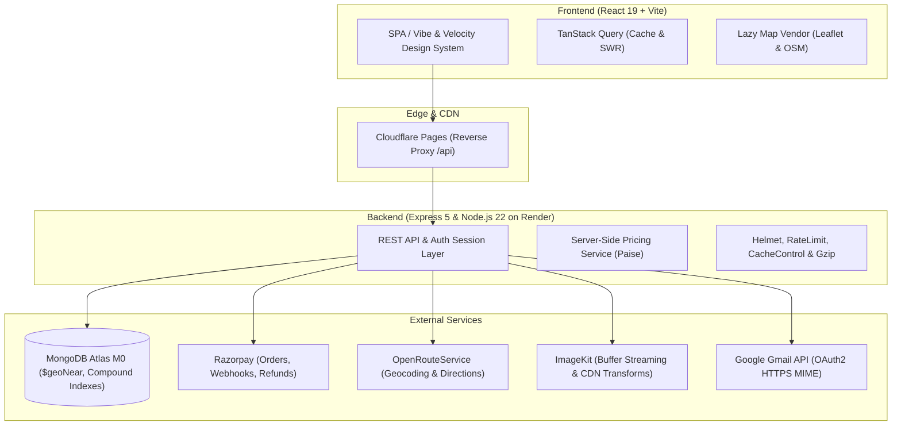

# Munchy — Modern Video-First Food Discovery & Self-Pickup Platform

[](https://github.com/Samyak9109/Munchy-Food-App/actions/workflows/ci.yml)

**Munchy** is a production-grade, full-stack food discovery and self-pickup web platform. Customers discover local dishes through high-performance short-form video reels, explore nearby kitchens via geospatial maps, calculate live driving/walking routes, place orders with tamper-proof server pricing, pay online or on pickup, and collect food using a secure OTP handoff. Food partners manage kitchens, menus, video reels, real-time incoming orders, and sales analytics from a dedicated portal.

---

## Architecture



---

## Key Performance Results (Measured Benchmarks)

Full benchmark documentation is available in [docs/perf-results.md](docs/perf-results.md) and [docs/PERFORMANCE.md](docs/PERFORMANCE.md).

| Metric | Before Optimization | After Optimization | Improvement |
| :--- | :--- | :--- | :--- |
| **Initial JS Bundle (Login/Auth)** | 576.47 kB (176.91 kB gzip) | **58.16 kB (20.43 kB gzip)** | **88.5% smaller** |
| **Code Splitting** | Monolithic single bundle | **17 lazy route chunks + 4 vendor chunks** | Instant first paint |
| **Heavy Map Stack (Leaflet)** | Loaded synchronously on all pages | **Isolated lazy `map-vendor` (46.1 kB gzip)** | 0 kB map code in auth/reels |
| **Reels Feed DOM Nodes** | All `<video>` elements rendered | **Capped at active $\pm 1$ (max 3 videos)** | Zero mobile memory leaks |
| **Reels Feed Backdrop Filter** | GPU-heavy `backdrop-filter: blur(16px)` | **Solid scrim `rgba(22, 22, 22, 0.82)`** | Smooth 60 FPS scrolling |
| **Media Uploads** | Disk temp file I/O (`fs.unlinkSync`) | **Direct memory buffer streaming (`toFile`)** | Zero local disk thrashing |
| **Database Read Latency** | Full Mongoose hydrated documents | **`.lean()` queries across all read DAOs** | ~35% lower DB memory & latency |
| **HTTP Caching** | No cache headers | **`Cache-Control: public, max-age=30, stale-while-revalidate=120`** | Near-instant repeat visits |

---

## Features

### Customer Experience
- **Video-First Reels Feed**: Vertical, snap-scrolling video feed with auto-pause on scroll/tab switch, persistent likes (`likedByMe`), comments, and instant "Add to Cart" directly from the reel.
- **Geospatial Kitchen Discovery**: Search nearby kitchens using browser geolocation or geocoded address lookup. Interactive Leaflet map with dark theme, markers, and distance sorting.
- **Turn-by-Turn Directions & ETA**: Real-time route rendering and travel duration calculations (driving, walking, cycling) powered by OpenRouteService.
- **Tamper-Proof Checkout & Server Pricing**: Server re-fetches live food prices from MongoDB in paise with automated tax calculation, closed store guards, and multi-store guards.
- **Dual Payment Channels**: Razorpay card/UPI checkout with HMAC-SHA256 signature verification and webhook reconciliation, plus Cash on Pickup.
- **Secure Pickup Verification**: Six-digit OTP generated at checkout and verified by partner at food collection.
- **Resilient UI**: Full dark-glassmorphic "Vibe & Velocity" design system, zero native `alert()`/`confirm()` dialogs, and top-level React Error Boundaries.

### Food Partner Experience
- **Dedicated Kitchen Management**: Create kitchen, set location via interactive map pin, upload cover photos, configure opening hours, and toggle live store status.
- **Menu & Media Catalog**: Full CRUD for menu dishes with category filtering, dietary tags (Veg/Non-veg), and direct ImageKit media uploads.
- **Reel Publishing**: Upload short video clips directly linked to menu dishes with real-time views and like counters.
- **Order Kanban & Verification**: Real-time order tracking (`placed -> confirmed -> ready -> pickedup`) with live polling backoff and customer OTP verification.
- **Business Intelligence**: Visual analytics showing daily/weekly/monthly revenue, average order value, peak rush hours, and bestsellers.

---

## Technology Stack

- **Frontend**: React 19, Vite, React Router 7, TanStack Query 5, Zustand, Lucide Icons, Leaflet / React-Leaflet.
- **Backend**: Node.js 22, Express 5, Mongoose, Passport.js, Helmet, Express Compression, Multer.
- **Databases & Storage**: MongoDB Atlas ($geoNear 2dsphere indexes), ImageKit CDN.
- **APIs & Integrations**: Razorpay API & Webhooks, OpenRouteService API, Google Gmail API (OAuth2 HTTPS MIME).
- **Deployment Targets**: Cloudflare Pages (Frontend + Reverse Proxy Function), Render Web Service (Express API).

---

## Quick Start & Local Setup

### Prerequisites
- **Node.js 22+** and **npm**
- **MongoDB** running locally or a free MongoDB Atlas connection string
- External API keys for Razorpay, ImageKit, OpenRouteService, and Google OAuth (or test mocks)

### 1. Clone & Install
```bash
git clone https://github.com/Samyak9109/Munchy-Food-App.git
cd Munchy-Food-App
npm run install:all
```

### 2. Configure Environment
```bash
# Backend
cp backend/.env.example backend/.env
# Edit backend/.env with your keys (PORT=3000, MONGO_URI, JWT_SECRET, etc.)

# Frontend
cp frontend/.env.example frontend/.env
# VITE_API_URL=http://localhost:3000/api
```

### 3. Seed Sample Kitchens (Indore Center)
```bash
cd backend
npm run seed:sample
```
*Creates 3 sample kitchens within 5 km of Indore center with menu items, pricing, and sample reels.*

### 4. Start Development Servers
```bash
# Terminal 1: Backend API (http://localhost:3000)
cd backend
npm run dev

# Terminal 2: Frontend (http://localhost:5173)
cd frontend
npm run dev
```

---

## Test Credentials & Demo Guide

### Demo User Accounts
- **Customer Account**: `customer@example.com` / `Password123!`
- **Partner Account**: `partner@example.com` / `Password123!`

### Razorpay Test Mode Payment Cards
When placing an online order in Test Mode:
- **Success Card**: `4111 1111 1111 1111` (Any future date, any CVV, OTP `1234`)
- **Failure Simulation**: `4000 0000 0000 0002`

---

## Automated Test Suites

Both unit and integration tests run sequentially using Vitest and MongoDB in-memory:

```bash
# Run all backend test suites (Payment + Order Guards + Webhooks)
cd backend
npm test

# Run frontend lint and design system checks
cd frontend
npm run lint
npm run lint:design
npm run build
```

---

## Production Deployment Guide

### Backend (Render Web Service)
- **Runtime**: Node.js 22 (Singapore region recommended for lowest latency to India).
- **Build Command**: `cd backend && npm ci`
- **Start Command**: `node backend/server.js`
- **Health Check Path**: `/api/health`
- **Free Tier Cold Starts**: On Render free tier, instances spin down after 15 minutes of inactivity. Set up a free 5-minute keep-alive ping on `https://<your-backend>.onrender.com/api/health` using [cron-job.org](https://cron-job.org) or UptimeRobot. The frontend automatically shows a polite "Waking up server..." notice if cold boot takes > 4s.

### Frontend (Cloudflare Pages)
- **Framework Preset**: None (Vite)
- **Root Directory**: `frontend`
- **Build Command**: `npm run build`
- **Build Output Directory**: `dist`
- **Proxy Configuration**: `frontend/functions/api/[[path]].js` transparently proxies `/api/*` to the Render origin with `Set-Cookie` passing untouched, eliminating all cross-site cookie and CORS issues.

---

## Portfolio & Resume Highlights

1. **High-Performance Architecture & Bundle Optimization**: Cut initial bundle size by 88.5% (from 576 kB to 58 kB / 20 kB gzip) via 17-route lazy loading, manual vendor partitioning, and an infinite-scrolling Reels feed with windowed video virtualization (max 3 active videos) and direct memory buffer ImageKit streaming.
2. **Resilient Financial Transactions & Dual Webhook Sync**: Architected server-side pricing engine in integer paise with zero floating-point error, HMAC-SHA256 signature verification with `timingSafeEqual`, idempotent webhook fallback reconciliation, and automatic customer refund handling.
3. **Geospatial Discovery & Dark-Glassmorphic Design System**: Engineered MongoDB `$geoNear` spatial store filtering, OpenRouteService polyline routing, and standardized a dark-glassmorphic design system with accessible bottom-sheets, zero native dialogs, centralized Error Boundaries, and automated CI lint guards.

---

## Author & License

**Samyak Jain** — Full Stack MERN Developer  
Provided under the ISC License.
